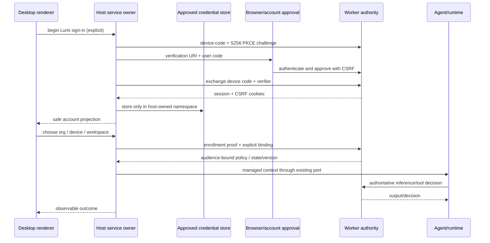

# Desktop/backend integration closure

Status: active; coordinator: this goal session. Base control plane a6de5e0,
client baseline fd977fd. Historical P08 closure remains historical; this plan
closes actual desktop wiring, not another backend-only phase.

## Phase delivery and review ownership

Latest human instruction: Claude Code is the primary implementer; Codex supervises,
reviews feedback and independently verifies claims. Each phase produces focused
commits and separate PRs in the parent and LumiAgents repositories where that
phase changes them. Do not collapse this goal into one cross-feature commit/PR.

| Delivery phase | Packets / behavior | Required history and order |
|---|---|---|
| Account and device | INT-01/02, FE-01/02 | Parent additive auth/device support, then child account/startup/enrollment; record preservation and recovery evidence |
| Workspace ownership | INT-03 | Parent binding/removal support, then child explicit adoption/rollback; no implicit conversion |
| Managed execution | INT-04 | Parent inference/tool/claim fixes, then child actual runtime wiring; security/failure proofs remain phase gates |
| Automations | INT-05 | Parent planner/producer/lease fixes, then child preview/scheduler; real execution/race/restart controls required |
| Release pair | QA-01/DEL-01 | Compatibility/recovery/clean-checkout evidence, merged-client gitlink PR and exact paired replay |

Shared files may require patch-level staging or dependent branches. Never stage
all dirty work merely because a phase has some PASS evidence. Preserve the
dependency-complete tree at every commit, use the PR templates and child DCO,
and record unresolved proof as FAIL/UNPROVEN/BLOCKED. A draft PR may expose work
for review, but merge waits for that phase's applicable exact-head gates.
Keep a delivery ledger with parent/client PR URLs, head and merge SHAs, dependency
PRs, evidence and final pin. Both remotes currently have no open PRs (live read
on 2026-10-08); no prior PR is assumed to deliver these pending changes.

### Delivery ledger

| Phase | Repository | PR / candidate | State and remaining proof |
|---|---|---|---|
| Account/device foundation | agents-cp.runlumi | [PR51](https://github.com/RunLumi/agents-cp.runlumi/pull/51), `e7ad897a7f400048df17100594ef86b3788ea0f1` | Draft; remote head read back. Hook passed on the current dirty workspace, so it is not exact-head certification. Clean phase-head checks, CI and recovery support follow-on required before merge. |
| Account/device foundation | LumiAgents | [PR39](https://github.com/RunLumi/LumiAgents/pull/39), `2a495254f0018644d24c9c1e5c5210bb7a30075c` | Draft; remote head read back. Node24 hook passed on dirty workspace; exact-head proof remains required. Recovery depends on additive parent PR52 landing first. |
| Device token recovery | agents-cp.runlumi | [PR52](https://github.com/RunLumi/agents-cp.runlumi/pull/52), `4f730a52c6ad8b0abde8f204f473315cf399d796` | Draft stacked on PR51; normal hooks, isolated quality/build and clean-head SDK/HTTP recovery proof passed with exact clean client2a49525. Hosted CI, Electron recovery UI and full-goal merge gates remain. |

## Contracts and execution sequence

Consume P02-CG v2, P03-CG v1, P04/P05/P06/P08-CG v1 and current change requests.
No frozen changes assumed. Missing contracts require explicit Change Requests.

| Packet | Responsibility / write surface | Dependencies |
|---|---|---|
| DE2E-INT-01 | Client spec and host account transport, shared service contract, credential persistence, isolated tests | P02 merged auth contract |
| DE2E-FE-01 | Desktop account/approval UI, existing service/hook boundary; backend desktop approval surface if missing | INT-01 |
| DE2E-INT-02 | Device key/enrollment/refresh/heartbeat/policy/recovery with storage/restart/revocation | INT-01, P03 |
| DE2E-FE-02 | Enrollment and remediation UX; preserve provider login and local mode | INT-02 |
| DE2E-INT-03 | Opaque per-workspace P03 binding, P08 ladder, ownership, restart and rollback | INT-02, P03/P08 |
| DE2E-INT-04 | Actual managed provider/session/run/auth/tool IPC runtime, attribution and settlement | INT-03, P04/P05 |
| DE2E-INT-05 | Import preview, scheduler claim/fence/start/settle and coexistence | INT-04, P06 |
| DE2E-QA-01 | Electron clean-profile harness, UI/runtime/storage hostile controls, faults, performance | each slice continuously |
| DE2E-DEL-01 | compatibility matrix, recovery docs, both PRs and authorized delivery/pin update | QA |

Each packet gets its own definition before code. Coordinator owns shared-file
registries and review. No agents delegated initially; execute sequentially.
Implementation paths will be frozen after client architecture context inspection.

## State ownership / sequence

ZCode/provider OAuth retains its own existing owner. Lumi context cannot replace
active provider credentials. Renderer receives projections, never session keys.

## Baseline gap matrix (source evidence, runtime still UNPROVEN)

| Claim | Evidence / gap | Verdict |
|---|---|---|
| Lumi account auth contract | routes/device_auth.rs issues session/CSRF cookies after S256 exchange; not a bearer token | source confirmed, runtime UNPROVEN |
| Browser verification route | start returns /desktop; inspect frontend route and approval UX before assuming it exists | UNPROVEN |
| Client adoption | packages/shared and CLI contracts P08 wizard exist; PR49 adapter is test-owned | module proven historically, product wiring UNPROVEN |
| Existing provider login | services/oauth/IOAuthService owns provider flows/credentials and cached-session state | source confirmed, preservation tests pending |
| Device lifecycle | backend enrollment/token/policy routes; full desktop owner/wiring not yet traced | UNPROVEN |
| Managed inference/tools | provider/shared/runtime seams present; actual desktop callers must be traced | UNPROVEN |
| Scheduler adoption | P06 lease schemas exist; actual scheduler owner/wiring must be traced | UNPROVEN |
| Local state survival | no actual Electron old-state/restart/rollback evidence in PR49 | UNPROVEN |
| A–E Electron integration | missing product harness and user journey proof | UNPROVEN |

## Evidence and completion

INT-03/04 coordinator also owns P03-CR-003 binding-removal queries/migration and
P08-CR-002 explicit rebind in migration route/repository plus client workspace
owner/transport. These extensions repair the demonstrated post-run rollback
and re-adoption failures; their runtime/hostile gates are mandatory.

Full goal remains authoritative: A–E actual Electron, hostile runtime/state
checks, reversible local migration, both repo quality/build gates, versioned
compatibility and focused PR handoffs. History sync remains disabled. No
production credentials/resources are touched for fixtures. Preserve ZCode login.
The user explicitly authorized two focused PRs and merge after this goal's gates pass; PR #49 authorization is not being reused.

P03-CR-002 is accepted as an additive follow-on because expired device tokens
otherwise have no safe recovery path. The V01-019 authenticated nonce route stays
unchanged. Recovery requires current human authorization plus one-time proof by
the original device key. Backend challenge consumption/token rotation/audit must
be atomic before DE2E-INT-02 may claim token-expiry recovery.

P03-CR-002 is accepted as an additive follow-on: human session + CSRF issues a
hashed five-minute recovery challenge; the original device key proves continuity;
D1 atomically consumes it, rotates token and audits. Keep the V01-019 authenticated
nonce path unchanged. Hostile gates cover replay, expiry, competing challenge,
removed member, suspended org, revoked device and minimum-version refusal.
